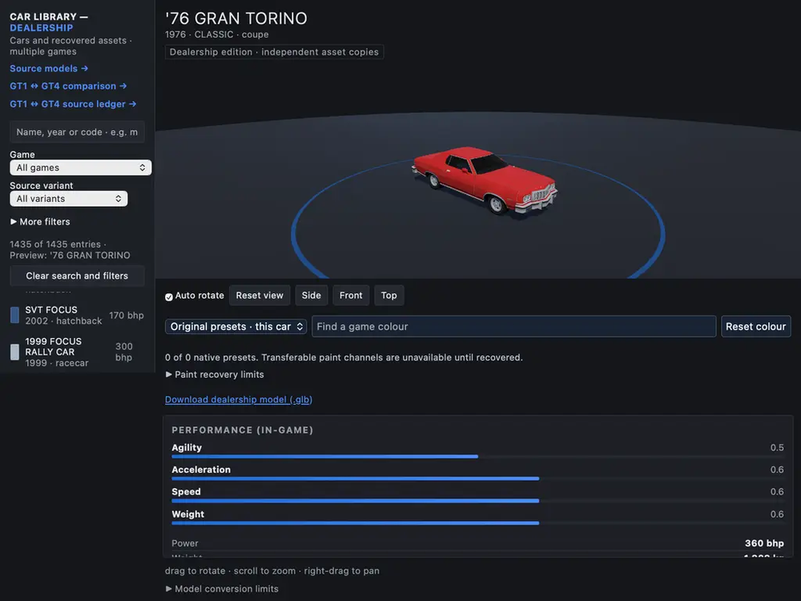
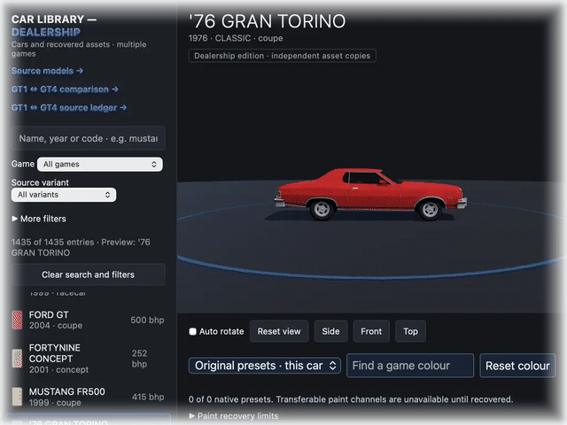
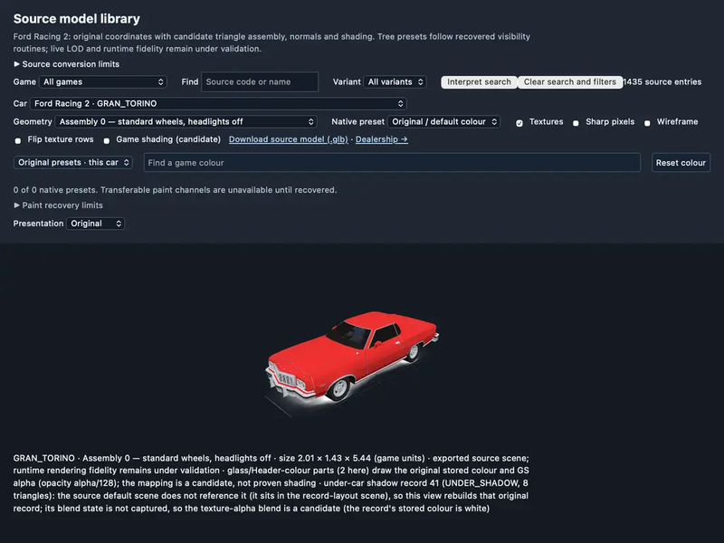
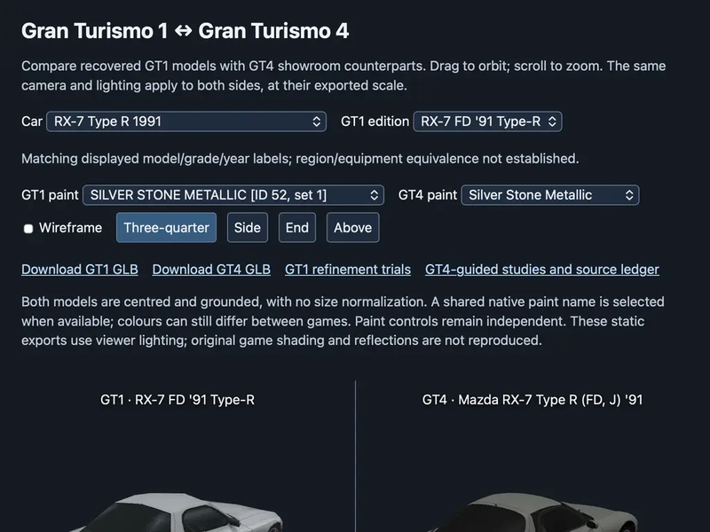

# carmodels

[**Open the live car showroom →**](https://nicolas-found42.github.io/carmodels/)
Browse the cars, choose a game, and drag to look around each model. No installation or GitHub knowledge needed.

1,435 recovered cars from six racing games — browsable as an editable dealership, inspectable as source geometry, and reproducible from disc by pinned, self-checking verifiers. Everything runs offline: models, three.js r182, and catalogs are committed, no npm install, no CDN.



## The apps

The [live showroom](https://nicolas-found42.github.io/carmodels/) runs on GitHub Pages.
The app and catalogs are hosted on Pages; larger models and native downloads load from the same
public GitHub commit. Updates to `main` publish automatically. Name search, game/variant filters,
camera controls and model downloads work on the live site; the optional natural-language search
below requires a local library server.

From the repository root:

```sh
python3 tools/build_dealership.py
python3 tools/build_model_catalog.py
python3 -m http.server 8080 --directory dealership
```

### Dealership — the editable edition

[`dealership.html`](dealership/dealership.html) is the default app: 1,435 cars across six games, each an independent editable GLB with catalog metadata, in-game performance bars, native paint presets where recovered, and a Blender-tested edit/export roundtrip. Search by name/year/code, filter by game and variant, orbit/zoom/pan, download any car as `.glb`.

<picture>
  <source media="(prefers-color-scheme: dark)" srcset="docs/screenshots/dealership-views-dark.gif">
  
</picture>

Edits live in `dealership/dealership/` (models + `catalog.json`); `python3 tools/build_dealership.py` recompiles only the display data and preserves edits. Source recovery never touches dealership copies — the fork history is in `origins.json`.

### Source inspector — the recovered originals

[`recovered.html`](dealership/recovered.html) shows the unedited recovery output per game: geometry records, texture variants, wireframe, filtering and row-flip controls, and full-model GLB download with every preset and material variant.



### GT1 ↔ GT4 comparison and ledger

Two research pages built on the Gran Turismo catalogs:

- [`gt1-gt4-compare.html`](dealership/gt1-gt4-compare.html) — side-by-side GT1 source model vs GT4 showroom counterpart at exported scale, same camera and lighting, independent paint controls, per-pair GLB downloads.
- [`gt1-upgrades.html`](dealership/gt1-upgrades.html) — the source ledger: which GT1 records map to which GT4 counterparts, with match evidence.
- [`gt1-enhanced.html`](dealership/gt1-enhanced.html) — GT1 refinement trials (RX-7 FD Type-RB), testing cleanup passes against the source geometry.



### Natural-language library search

The game/variant phrase box (`Find game and variant`) runs through the library server instead of static hosting:

```sh
python3 tools/serve_library.py --port 8081
```

Exact game and variant phrases ("Redline mods", "GT night", "everything") match on the server with no network access. Other wording is sent, with the catalog's game/variant counts, to the TypeSafe model through OpenRouter, which needs `typesafe-sdk` importable by that Python and `OPENROUTER_API_KEY` in its environment; without them the server says so at startup and in the page. Uncertain answers never change the filters.

Optional dev environment: `pyproject.toml` pins the guarded extras (Pillow, numpy, ruff, `typesafe-sdk`) as uv dependency groups; checks run on stdlib only and never need it.

```sh
uv sync --all-groups   # creates .venv/ with every group
source .venv/bin/activate   # uv sync does not activate; without this,
                             # python3 resolves from PATH, not .venv
python tools/serve_library.py --port 8081   # uses the venv python
```

## The corpus — six games, 1,435 cars

| Game | Cars | Source |
| --- | --- | --- |
| Ford Racing 2 (PS2, SLES-51705) | 35 | `games/ford-racing-2/` — verbatim extraction + hash-verified `recovered/` manifests |
| Gran Turismo (PS1, SCUS-94194) | 342 | `games/gran-turismo/` — `model.car`/`textures.tex` day/night/arcade pairs, `CARINF.DAT` metadata |
| Gran Turismo 4 (PS2, SCES-51719) | 730 | `games/gran-turismo-4/` — RoFS `GT4.VOL` volume, SpecDB joins, preview renders |
| Redline (Mac) | 128 | `games/redline/` — mesh + texture recovery with tamper-controlled decoders |
| Midnight Club 3: Remix (PS2) | 94 | `games/midnight-club-3-remix/` — decoded models with preview geometry |
| Midnight Club: Los Angeles (X360) | 106 | `games/midnight-club-los-angeles/` — RPF3/LZX resources, RSC5 decoding, catalog names |

Each game tree keeps the same shape: `cars/` source tree, per-game README indexing tools/notes/evidence, and hash-pinned manifests. Evidence locations vary by game — GT4 keeps source identity under `cars/provenance/`, Redline under `research/evidence/redline-extraction/` and `research/evidence/redline-library/`; each game's README names its exact paths. Disc images and private inputs stay local and ignored; receipts pin their SHA-256 so a verifier refuses the wrong input. See [ADR 0003](docs/adr/0003-game-sources-live-under-games.md) and [CONTRIBUTING.md](CONTRIBUTING.md).

## Repository layout

- `dealership/` — app entry points, shared vendor libraries and compiled browser data. See [the app guide](dealership/README.md).
- `dealership/dealership/` — independent editable GLBs, catalog and initial-fork provenance. See [the editing guide](dealership/dealership/README.md).
- `dealership/public/` — compiled per-game indexes, GLBs, game paints and shading data; `models.json` joins them all.
- `games/<game>/` — each game's source tree, with a README indexing its tools, notes, evidence and published files.
- `research/` — recovery notes and evidence receipts. Open items are indexed in [research/README.md](research/README.md).
- `tools/` — recovery, export, build and verifier scripts.
- `docs/screenshots/` — the images and GIFs on this page, captured from the live apps.
- `docs/adr/` — architecture decisions; `.github/` — issue/PR templates and CI.

`tools/build_dealership.py` reads the editable dealership inputs and preserves edits. `tools/build_showcase.py` remains a compatibility entry point for that build. Recovery/export commands write source outputs without replacing dealership models.

## Adding games

Put source assets in `games/<game>/`, named with lowercase words separated by hyphens. Keep original models, textures, configuration, sounds and recovery manifests together. Put exported source GLBs and an `index.json` under `dealership/public/<game>/`. Each index has `cars` records with `code`, `file`, `bytes`, `sha256` and `records`.

Run `python3 tools/build_model_catalog.py` to rebuild `dealership/public/models.json`. The source inspector identifies models by game plus code, so different games can share a car code. The dealership remains an independently edited edition; source catalog updates do not replace it.

## Fidelity and verification

The original-coordinate mapping reproduces all 1,837 nonempty Ford Racing 2 geometry records' bounds. Triangle-strip, normal, UV and texture-selector interpretations retain their documented candidate limits. The dealership's baked display geometry and illustrative body tint do not establish original game shading. Full game-render equivalence remains open. See [the recovery report](research/original-recovery.md) and [the app guide](dealership/README.md).

Every verifier is self-checking: it mutates copies of the corpus (rehashed manifests, swapped records, altered declarations) and requires every mutation to be rejected. A pass means the corpus is unaltered **and** the tamper controls still fire — not merely "no exception was raised". Success prints `VERIFY OK` / `PASS` and exits 0; anything else exits non-zero.

Run `tools/check.sh` before a PR. It retains complete logs and pass/fail/skip states, verifies corpus integrity using tamper controls, checks app load recovery and dealership independence, and runs the Blender edit/export regression when its runtime is available. `tools/check.sh --games` adds game-tool tests, or `--game <slug>` selects one game's tests. Bulk disc/corpus and private-input checks require `--full` or an explicit `--only`; `--game <slug> --full` limits re-derivation to that game. Read [CONTRIBUTING.md](CONTRIBUTING.md) for inputs and the scope of each check.
